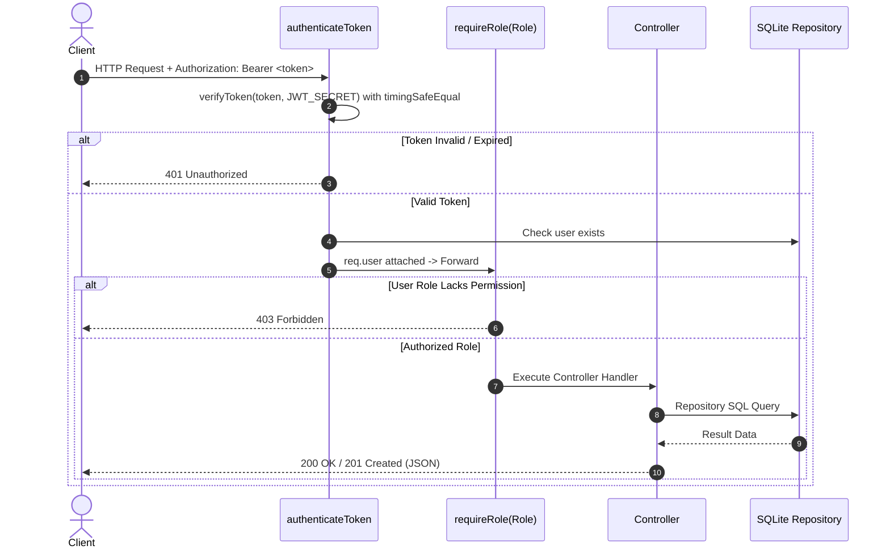

# RecruitHub - Full-Stack Campus Placement Portal

A clean-architecture Full-Stack Campus Recruitment & Placement Portal designed specifically for portfolio demonstration and technical interview walkthroughs.

RecruitHub manages the end-to-end college recruitment cycle: from corporate recruiters publishing placement drives with academic cutoff criteria (minimum CGPA and eligible branches), to students tracking application stages in real-time (`Applied` → `Shortlisted` → `Interview` → `Offered`), to Training & Placement Officers (TPO) monitoring institute-wide placement analytics.

---

## 🚀 Key Highlights for Technical Interviews

1. **Custom JWT Auth From Scratch (Zero 3rd-Party JWT Libraries)**:
   - Handcrafted token generation, Base64URL encoding, HMAC-SHA256 cryptographic signing, and claims verification using Node's native `crypto` module.
   - Mitigates **Timing Attacks** by enforcing constant-time signature comparison with `crypto.timingSafeEqual()`.
2. **Strict Role-Based Access Control (RBAC)**:
   - Granular middleware security separating `STUDENT`, `RECRUITER`, and `TPO_ADMIN` roles across all REST endpoints.
3. **Repository Pattern with SQLite**:
   - Clean separation of database queries from HTTP controllers. Enables switching from SQLite to PostgreSQL with zero modifications to business logic.
4. **Boilerplate-Free State Management (Zustand)**:
   - Eliminates Redux boilerplate (reducers, actions, context providers) while preventing React Context re-render cascades through fine-grained selectors.
5. **1-Click Portfolio Demo Switcher**:
   - Switch effortlessly between student profiles (e.g. Alice with CGPA 9.1 vs. Bob with CGPA 7.8), recruiter accounts (Google, Microsoft), and the TPO Admin console with a single click.

---

## 🛠️ Tech Stack

| Layer | Technologies |
|---|---|
| **Frontend** | React (Vite), Zustand, Tailwind CSS, Lucide Icons |
| **Backend** | Node.js, Express.js |
| **Authentication** | Custom HMAC-SHA256 JWT, Native `crypto.scrypt` Password Hashing |
| **Database** | SQLite (`better-sqlite3`) with WAL Mode & Foreign Keys |
| **Architecture** | Clean Architecture, Repository Pattern, RESTful API V1 |

---

## 📁 Flat & Intuitive Directory Structure

```text
RecruitHub/
├── server/
│   ├── src/
│   │   ├── config/              # Centralized environment variables
│   │   ├── utils/
│   │   │   ├── customJwt.js     # Manual JWT signing, verification & timingSafeEqual
│   │   │   └── password.js      # Scrypt password hashing with random salt
│   │   ├── db/
│   │   │   ├── schema.sql       # Relational tables & indexes
│   │   │   ├── database.js      # better-sqlite3 connection with WAL mode
│   │   │   └── seed.js          # Realistic demo accounts & drives
│   │   ├── repositories/        # Clean Data Access Layer (SQL queries)
│   │   │   ├── userRepository.js
│   │   │   ├── driveRepository.js
│   │   │   ├── applicationRepository.js
│   │   │   └── adminRepository.js
│   │   ├── middleware/
│   │   │   ├── authMiddleware.js # authenticateToken & requireRole(...roles)
│   │   │   └── errorHandler.js   # Centralized error handler
│   │   ├── controllers/         # Business logic for REST API
│   │   │   ├── authController.js
│   │   │   ├── driveController.js
│   │   │   ├── applicationController.js
│   │   │   ├── studentController.js
│   │   │   └── adminController.js
│   │   ├── routes/              # Modular Express routers
│   │   └── server.js            # Express app bootstrap & middleware mounts
│   ├── test-auth.js             # Verification script for custom JWT crypto
│   └── test-direct.js           # Integration test suite for repositories & controllers
│
└── client/
    ├── src/
    │   ├── api/                 # Lightweight fetch wrapper with Bearer token injector
    │   ├── store/               # Zustand state stores (useAuthStore, useDriveStore, ...)
    │   ├── components/          # Reusable UI (Navbar, DriveCard, ApplicationTracker, Modals)
    │   ├── pages/               # Role dashboards (Student, Recruiter, TPO Admin, Auth)
    │   ├── App.jsx              # Role-aware view coordinator
    │   └── main.jsx
    ├── vite.config.js
    └── tailwind.config.js
```

---

## 🔐 Custom JWT: Deep Dive & Technical Walkthrough

A standard JSON Web Token consists of 3 dot-separated segments:
$$\text{Token} = \text{Base64Url}(\text{Header}) \mathbin{\Vert} "." \mathbin{\Vert} \text{Base64Url}(\text{Payload}) \mathbin{\Vert} "." \mathbin{\Vert} \text{Base64Url}(\text{Signature})$$

### 1. Base64URL Encoding
Standard Base64 contains `+`, `/`, and `=` padding. To make tokens URL-safe and header-safe:
- Replace `+` with `-`
- Replace `/` with `_`
- Strip trailing `=` padding

### 2. Cryptographic Signing (HMAC-SHA256)
Using Node's native `crypto.createHmac('sha256', secret)`:
```javascript
const message = `${encodedHeader}.${encodedPayload}`;
const signature = crypto.createHmac('sha256', secret).update(message).digest('base64url');
```

### 3. Mitigating Timing Attacks (`crypto.timingSafeEqual`)
In standard string equality (`receivedSignature === expectedSignature`), the JavaScript engine compares character-by-character and aborts upon finding the first mismatched byte. An attacker measuring microscopic response times across thousands of network packets can deduce bytes one by one.

By converting signatures into byte buffers and using `crypto.timingSafeEqual()`, comparison takes constant time regardless of where mismatches occur, eliminating timing side-channels.

---

## 👥 Role-Based Access Control (RBAC) Flow



---

## 🚦 Application State Machine

Student applications follow a strict stage progression:

```text
[ APPLIED ] ───────► [ SHORTLISTED ] ───────► [ INTERVIEW ] ───────► [ OFFERED ]
     │                      │                       │
     └──────────────────────┴───────────────────────┴──────────────► [ REJECTED ]
```

- When a student applies, the backend enforces eligibility:
  - `drive.status === 'OPEN'`
  - `currentDate <= drive.deadline`
  - `student.cgpa >= drive.min_cgpa`
  - `drive.eligible_branches.includes(student.branch)`
  - Application deduplication (students cannot apply twice to the same drive).

---

## ⚡ Quick Start & Demo Setup

### Prerequisites
- Node.js (v18+)
- npm (v9+)

### 1. Install & Seed Backend
```bash
# Navigate to server
cd server

# Install dependencies
npm install

# Seed database with realistic demo accounts, drives, and applications
npm run seed

# Run automated tests to verify custom JWT & business logic
npm test

# Start backend server (runs on http://localhost:5000)
npm run dev
```

### 2. Start Frontend
In a new terminal window:
```bash
# Navigate to client
cd client

# Install dependencies
npm install

# Start Vite development server (runs on http://localhost:3000)
npm run dev
```

---

## 🎯 Pre-Configured Demo Accounts

For instant portfolio walkthroughs, RecruitHub features **1-Click Demo Buttons** on the login page and in the top navigation bar:

| Role | Email | Password | Persona & Highlights |
|---|---|---|---|
| **Student (High CGPA)** | `alice@student.edu` | `Student@123` | Alice Chen • CGPA: **9.1** • CSE • Applied to Google & Amazon (Offer Secured) |
| **Student (Average CGPA)** | `bob@student.edu` | `Student@123` | Bob Smith • CGPA: **7.8** • IT • Shortlisted for Microsoft |
| **Student (Cutoff Test)** | `charlie@student.edu` | `Student@123` | Charlie Dave • CGPA: **6.8** • ECE • Demonstrates CGPA cutoff rejection |
| **Recruiter (Google)** | `google@recruiter.com` | `Recruiter@123` | Sundar Kumar • Lead Recruiter • Posted SDE-1 (24 LPA) |
| **Recruiter (Microsoft)**| `microsoft@recruiter.com` | `Recruiter@123` | Satya Priya • Talent Partner • Posted Cloud & DevOps (16.5 LPA) |
| **TPO Admin** | `admin@college.edu` | `Admin@123` | Prof. Rajesh Sharma • Placement Director • Full Institutional KPI Analytics |

---

## 💡 Interview Q&A Cheatsheet

### Q1: Why did you build custom JWT instead of using `jsonwebtoken`?
> *"In a production application, battle-tested libraries are standard, but implementing JWT from RFC 7519 demonstrates a solid grasp of web security fundamentals: cryptographic hashing (HMAC-SHA256), Base64URL string manipulation, payload serialization, and token expiry lifecycles. It also allowed me to implement constant-time signature comparison to protect against timing attacks, which is an important security detail."*

### Q2: Why choose Zustand over Redux Toolkit or React Context?
> *"React Context triggers re-renders across all consuming components whenever any value in the context object changes. Redux Toolkit solves this but introduces heavy boilerplate (slices, action creators, reducer switch cases, store providers). Zustand provides fine-grained selectors with zero wrapper providers, minimal memory footprint, and native support for async actions right inside the store."*

### Q3: Why use SQLite with the Repository Pattern?
> *"SQLite with Write-Ahead Logging (WAL) is self-contained and requires zero database daemon configuration, making this project instantly testable for evaluators. By layering a clean Repository Pattern over the raw SQL queries, the application achieves decoupling: if we migrate to PostgreSQL or MySQL, only the repository SQL statements change, while all controllers, middleware, and business logic remain completely untouched."*

---

## 📜 License
MIT License. Created by [Priyanshu Singh](https://github.com/Priyanshu-i) for portfolio and interview demonstration.
